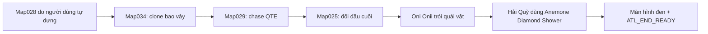

# Cảnh clone, truy đuổi và đối đầu Atlantis — Map034, Map029, Map025

> **Tài liệu lịch sử.** Map025 hiện đã nối Map029 → Map025 → Map035 → Map036. Các đoạn “dừng trước hội tụ”, prototype và hướng chạy cũ bên dưới chỉ ghi lại quá trình thiết kế; `maps/README.md` và `routes/README.md` là tài liệu hiện hành.

Trạng thái: đã duyệt và triển khai bản playtest vào Map029/Map025.

## 1. Nguồn và giới hạn

Nguồn chính là `docs/kich ban/Xuống Atlantis Mua Sách Phép.docx`, phần `Cảnh số 5`, từ đoạn “Hải Quỳ chạy thoát khỏi hành lang gương” đến “Màn hình đen. Sang thẳng cảnh cuối”. Không sáng tác thêm lời thoại.

DOCX được bố trí theo nhiều cột/nhánh nên phần nằm sau màn hình đen không thể xác định chắc chắn là bước kế tiếp trực tiếp của ending Atlantis hay nội dung song song của hai lựa chọn sách. Vì các nguồn có độ ưu tiên ngang nhau, bản triển khai này sẽ dừng trước hội tụ và không tự nối sang tiệc.

## 2. Những điểm sai hoặc thiếu hiện tại

- Map029 bắt đầu minigame ngay, thiếu đoạn Hải Quỳ thở dốc, các clone tiến lại gần và bóng quái vật xuất hiện.
- Map025 hiện chỉ có ba câu reveal rút gọn.
- Câu `Cái tên Aira vẫn còn vang lên trong đầu mình.` ở Map025 không có trong đoạn nguồn và phải xóa.
- Map025 thiếu toàn bộ đối đầu với Quái Vật Vực Sâu, Oni Onii xuất hiện, `ECLIPSE BLOCKCHAIN` và `ANEMONE DIAMOND SHOWER`.
- Map025 hiện bật flag ngay trước khi diễn biến thật sự hoàn tất.

## 3. Flow đề xuất

## 4. Map034 — clone bao vây trước minigame

### 4.1. Nhịp cảnh

1. Hải Quỳ đứng thở hồng hộc; cho phép save nếu hệ thống save tại cảnh không gây gián đoạn.
2. Hiện nguyên văn các câu của `???`:
   - `Nghĩa vụ của ngươi…`
   - Hải Quỳ đáp `Im đi! Im đi! Im đi!`
   - Các clone xuất hiện rải rác rồi tiến gần.
   - Tiếp tục toàn bộ chuỗi từ `Nghĩa vụ của chúng ta…` đến `Thất bại. / Thành công. / Thảm hại.`
3. Dùng CE7 `FX — Horror Tension` khi clone xuất hiện.
4. Dùng CE6 `FX — Shock`, screenshake và SE khi clone biến mất, bóng quái vật lớn xuất hiện sau Hải Quỳ.
5. Gọi CE3 để xóa tone/blur của CE7, dọn KUL của Map034 rồi transfer sang Map029.

Map034 có 11 clone E003–E013, dùng `$Clone1`–`$Clone11`; mỗi clone sở hữu đúng một câu thoại nguồn, dùng Pop Message theo chính event ID và mang nguồn sáng tím động `atlantis_clone`. Map029 không lặp lại thoại mở đầu và dùng đủ 11 clone E003–E013 (`$Clone1`–`$Clone11`) làm vật cản QTE. Một túi xáo trộn buộc cả 11 xuất hiện trước khi lặp.

Nhịp kết Map034: các clone lần lượt chạy tới bám sát Hải Quỳ; sau khi tất cả tới nơi, Hải Quỳ quát `Buông tao ra!` và đánh văng cả vòng vây. Balloon `!` cùng hướng quay lên báo nhịp phát hiện, rồi quái vật mới tiến từ ngoài khung hình vào, gầm và dẫn sang chase.

Map029 chạy theo trục dọc hướng xuống: Hải Quỳ ở phần trên màn hình, các clone xuất hiện phía dưới và quái vật đuổi từ phía trên. Hướng này thống nhất với frame quay xuống của `Monster1`.

Paulie xuất hiện bằng high-drop hai giai đoạn: camera lên cao trong khi overlay còn ẩn, sau đó hiện ba frame đầu `$OniOnii_landing` trong shot đen và cùng camera đáp xuống. Impact dùng animation 138; khi animation kết thúc mới đổi về `$OniOnii`. Animation khống chế 139 phát trên quái vật trước atlas trói. Paulie nhảy tới bên phải Hải Quỳ, cách hai ô; cả hai quay vào nhau để đối thoại trực diện. Đòn kết thúc dùng animation 147, làm xác quái vật vỡ thành mảnh trong lúc camera blur và tối dần trước khi chuyển sang Map035.

### 4.2. Hiển thị thoại

- Quy tắc dự án được người dùng chốt sau đó có ưu tiên cao hơn ghi chú trình bày trong DOCX: lời nhân vật nói dùng Pop Message. Hải Quỳ dùng `\bm[0]`; giọng quái vật dùng event anchor E002.
- Không thêm tên Aira hoặc giải thích nguồn gốc ở đoạn này.

### 4.3. Clone

- Dùng đầy đủ charset `$Clone1`–`$Clone17`; `$Clone7.gif` một frame đã được chuyển nguyên pixel sang `$Clone7.png` để RGSS3 đọc qua `Cache.character`.
- Trong chase, clone cản đường được xử lý bằng QTE: nhập đúng để Hải Quỳ đánh văng; nhập sai hoặc hết giờ tăng danger. Chúng không dùng collision chạm tự do ngoài QTE.
- Sau CE6, xóa/ẩn toàn bộ clone trước khi bắt đầu chase để không còn hitbox thừa.
- Chase chạy theo trục dọc: Hải Quỳ chạy lên, quái vật ở dưới, clone cản đường xuất hiện phía trên.

## 5. Map025 — đối đầu cuối chase

### 5.1. Event dự kiến

| ID dự kiến | Tên event | Vai trò |
|---|---|---|
| E001 | `SCN-ATL-POST-CHASE [E001]` | Autorun điều phối toàn cảnh |
| E002 | `NPC-ATL-ABYSS-MONSTER [E002]` | Quái vật Vực Sâu, camera/Pop anchor |
| E003 | `NPC-ATL-ONI-ONII [E003]` | Oni Onii/Paulie xuất hiện ở nửa sau |
| E004+ | `FX-ATL-CLONE [E004...]` | Clone nền nếu cảnh cần giữ áp lực hình ảnh |

Oni Onii là Paulie. Graphic sẽ tái sử dụng graphic Paulie/Oni Onii đã có trong project; không tự đặt tên thật của anh cả.

### 5.2. Pha A — quái vật ép Hải Quỳ phủ nhận bản thân

Giữ nguyên thứ tự thoại từ:

- `Ngươi… / Chấp nhận… / Nghĩa vụ… / Bản năng…`
- Hải Quỳ phản bác.
- `Đã là phế phẩm… / Còn dám lên tiếng sao…?`
- Hải Quỳ: `Ta là…Dahria…!`
- Quái vật phủ nhận tên và thân phận của Hải Quỳ.

Camera dùng CE2 tập trung E002; các câu Hải Quỳ dùng Pop Message `\bm[0]`, câu quái vật dùng `\bm[2]` nếu không thuộc nhóm overlay được nguồn chỉ định.

### 5.3. Pha B — Hải Quỳ tự xác lập danh tính

Giữ nguyên toàn bộ đoạn:

- `Dahria…có thể không phải tên của ta.`
- `Ta sẽ khẳng định…Dahria…chính là ta!`
- `TA!`
- `Không phải thí nghiệm, tạo vật hay phế phẩm thất bại mà ngươi nói!`

Không chèn Aira vào đoạn này vì nguồn không có Aira đối thoại. Có thể dùng CE4 focus Player, ánh sáng tăng nhẹ và camera tiến gần để làm rõ bước chuyển từ dao động sang chủ động.

### 5.4. Pha C — Oni Onii can thiệp

1. Quái vật tiến sát.
2. Hải Quỳ nhắc rằng anh trai mình cực ghét Quái Vật Vực Sâu.
3. Camera chuyển sang E003.
4. Oni Onii xuất hiện từ phía trên/bên ngoài khung hình và nói nguyên văn `ECLIPSE BLOCKCHAIN!!!`.
5. Dùng animation trói có sẵn làm placeholder; không viết một hệ thống chiến đấu mới cho riêng một cutscene.
6. Oni Onii nói hai câu về việc chờ Hải Quỳ úp mì và yêu cầu giải quyết quái vật.

Oni Onii và Hải Quỳ đều dùng Pop Message đúng event anchor: Oni Onii `\bm[3]`, Hải Quỳ `\bm[0]`.

### 5.5. Pha D — kết liễu

1. Hải Quỳ nói `Biết rồi!!!`.
2. Hải Quỳ dùng `ANEMONE DIAMOND SHOWERRRRRRR`.
3. Dùng animation/SE/flash/screenshake có sẵn; camera lùi nhẹ để thấy cả Hải Quỳ và quái vật.
4. Fade to black.
5. Bật Switch 33 `ATL_END_READY` và đặt Variable 30 `ATL_STEP` sang bước hoàn tất route trước hội tụ.
6. Reset Enhanced Camera trực tiếp và dọn toàn bộ KUL light sau khi màn hình đã đen; Map025 không gọi CE3 vì CE3 kích hoạt lại Map Effects.

Map035 dùng `Game_Player` thay cho event Hải Quỳ riêng để giữ đúng form/graphic hiện tại của người chơi. Toàn bộ thoại Hải Quỳ dùng Pop Message `\bm[0]`; animation/balloon nhắm vào Player. Paulie phát animation teleport 116 có wait trước khi E003 bị ẩn.
7. Dừng tại màn hình đen hoặc một event gate không playable; chưa transfer tới tiệc cho đến khi điểm nối được duyệt.

## 6. Điều kiện và flag

| State | Thời điểm |
|---|---|
| Switch 36 `ATL_CHASE_CLEARED` | Script chase bật khi sống sót đủ thời gian |
| Map025 autorun | Chỉ chạy nếu Switch 36 đang ON |
| Switch 33 `ATL_END_READY` | Chỉ bật sau khi beam kết liễu hoàn tất |
| Variable 30 `ATL_STEP` | Tăng sau fade-out; không tăng ở đầu Map025 |

Map025 cần page dự phòng nếu được mở bằng editor/test mà Switch 36 OFF, tránh autorun ending ngoài route.

## 7. Tài nguyên và kỹ thuật

- Map25 có thể tiếp tục dùng RTP/placeholder vì đây là cutscene, nhưng cần không gian đủ để chứa Player, quái vật phóng lớn và Oni Onii. Kích thước hiện tại `17×13` đủ cho khung tĩnh; nếu graphic quái vật bị cắt mới tăng map sau khi đo sprite.
- Dùng `MOG Character Effects` cho quái vật lớn/xuất hiện; không áp dụng phóng to/thu nhỏ lên Hải Quỳ.
- Dùng KUL `player_small` hoặc nguồn sáng cục bộ nếu nền tối; dọn light trước transfer.
- Dùng CE2/CE4/CE6/CE7/CE3 theo hệ common event camera hiện có.
- Mọi Show Text phải reflow theo khung VX Ace; không đặt cả câu dài vào một dòng.

## 8. Tiêu chí playtest

1. Vừa hết chase chuyển Map25 không còn lỗi KUL.
2. Không có câu thoại tự viết hoặc câu Aira ngoài nguồn.
3. Pop Message bám đúng Player/E002/E003 và không phát sinh thoại Aira.
4. Camera không cắt quái vật hoặc Oni Onii.
5. Animation trói hoàn tất trước animation beam.
6. Light, camera, character effect và HUD chase đều được dọn sạch.
7. Switch 33 và Variable 30 chỉ đổi sau câu kết liễu.
8. Cảnh dừng trước hội tụ, không tự transfer tới tiệc.
