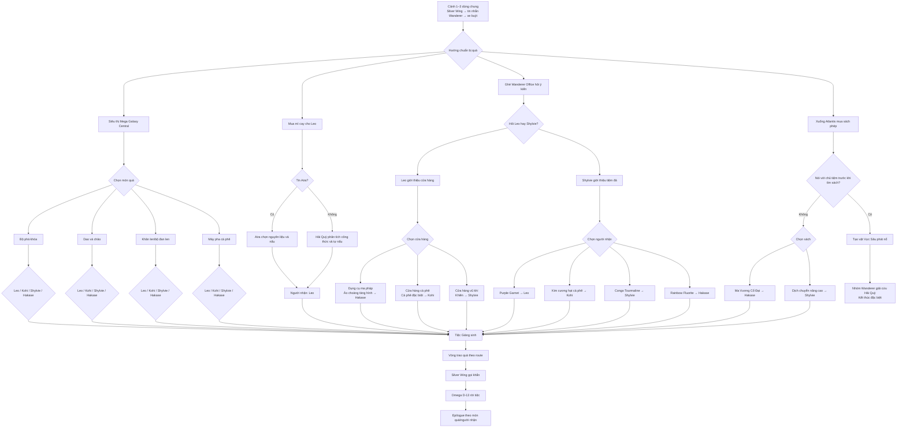
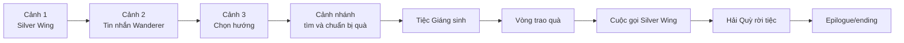

# Sơ đồ route

File này lưu mã Mermaid dùng để kiểm tra cấu trúc route. Nội dung chi tiết và quy tắc triển khai nằm trong [04-route-map.md](./04-route-map.md).

## Cây route tổng thể

## Luồng scene tiêu chuẩn

## Nhánh Atlantis đặc biệt

```mermaid
flowchart LR
    SHOP["Tiệm sách Atlantis"] --> TALK["Nói chuyện với chủ tiệm trước"]
    TALK --> BOX["Nhận hộp bà chủ cũ để lại"]
    BOX --> EXPLODE["Sách Vực Sâu phát nổ và nhập vào Hải Quỳ/Aira"]
    EXPLODE --> SEAL["Tự phong ấn"]
    SEAL --> TRACE["Wanderer dò ma lực từ băng đạn"]
    TRACE --> RESCUE["Hakase học Oblivion Blast"]
    RESCUE --> EXORCISE["Trục xuất Quái Vật Vực Sâu"]
    EXORCISE --> END["Kết thúc đặc biệt"]
```

