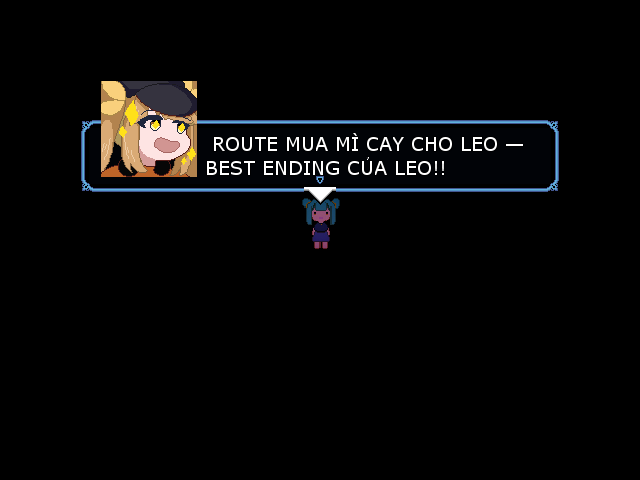
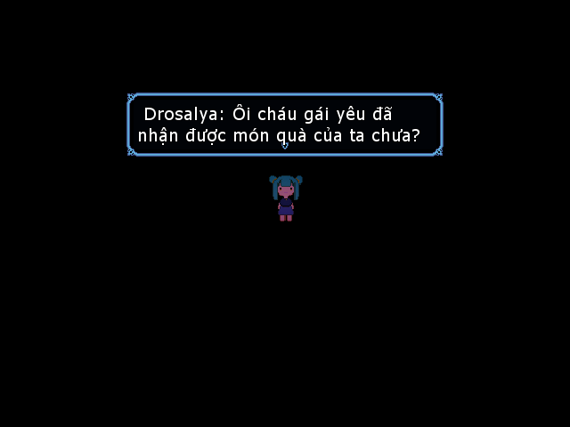

# Đồng bộ ending hint — 19/11/2026

Map036 có 28 page, chọn bằng Variable 41. Trước sửa, chỉ hint 1/19/20 dùng pop; nhóm siêu thị dùng CE05 zoom/tint và CE03 reset, hint mì cay dùng fade chuẩn, các nhóm sau có KUL nhưng reveal/đèn không đồng nhất. Đây là các cách dựng khác nhau trong cùng router, không phải 28 map khác nhau.

## Hành vi thống nhất

- Map note bật KUL, màu đen và opacity 255 ngay lúc setup. Xóa đèn player, tone, flash, shake, picture và hiệu ứng camera còn lại từ map nguồn trước khi tạo spriteset. Không hiển thị tên map nội bộ trên sân khấu hint.
- Dùng đèn `cutscene_actor` hiện có, không nhấp nháy. Đèn và lớp tối cùng fade trong 30 frame; camera zoom nhẹ 100→110%, Bully Quỳ có hiệu ứng Breath. Giữ nguyên các balloon tác giả đã đặt.
- Cả 204 Show Text dùng pop. Bully Quỳ trỏ vào E002; các câu vô diện Drosalya dùng neo trên màn hình, không có đuôi trỏ vào nhân vật khác. Chưa có sprite/face Drosalya nên không lấy tài nguyên của người khác thay thế. Placeholder tài nguyên cũ ở hint 24 giữ nguyên để không tự sửa nội dung ngoài phạm vi.
- Sau thoại: nghỉ 12 frame, fade nguồn đèn 255→0 đồng thời KUL về đen hoàn toàn và zoom về 100% trong 30 frame. Sau đó mới dọn đèn, Breath, neo giọng nói, camera và pop; giữ lệnh nền Title đã có của từng nhánh.
- Nhạc vẫn là `sad magic`. Giữ nguyên chữ, xuống dòng, face/index, điều kiện page, Hint ID, nền Title, vị trí event, graphic và walk/step của map.

## Lỗi viewport phát hiện qua ảnh

Map036 chỉ 17×13 ô. Yanfly tạo viewport `(48,32,544,416)`, trong khi KUL vẽ mask theo toàn màn hình và Map Effects dùng snapshot toàn màn hình. Khi zoom, ánh sáng có thể lệch khỏi sprite dù `give_light` đã chạy.

Chỉ Map036 dùng viewport `(0,0,640,480)`. Camera căn giữa theo vị trí hiện tại của E002, không di chuyển event hoặc đổi kích thước/tile map. Zoom dùng animation trực tiếp của Map Effects để tránh `set_zoom` gọi `Player.center` mỗi tick và đưa camera trở lại giới hạn map nhỏ. Mọi map khác vẫn dùng phép tính viewport gốc.

## Thành phần sửa

| Thành phần | Thay đổi |
|---|---|
| Map036 E001, 28 page | Chỉ thay danh sách lệnh trình bày; dùng helper chung và pop; thêm note KUL |
| Game_Map, slot 31 | Dọn trạng thái vào sân khấu hint trước frame hiển thị đầu; trả thiết lập khi rời |
| Game_Interpreter, slot 40 | WCFEndingHint và các helper start/reveal/fade/finish dùng chung |
| Yanfly Core Engine, slot 130 | Viewport toàn màn hình riêng Map036 |
| Pop Message, slot 203 | Cho phép neo giọng ngoài khung hình ẩn đuôi; pop thông thường tự hiện lại đuôi |

Giữ nguyên 222 slot, ID/tên/thứ tự và 221 dòng CSV. Backup: `Data/codex_backup_ending_hint_20261119/`. Không cập nhật web app QA, không sửa các map route hay hai lỗi tương tác siêu thị còn mở.

## Kiểm tra

- Native `Save/EndingHintQA_20261119_verified/`: đủ 28 hint, 204 khung thoại, về Title đúng nền và không crash. Các lượt vào được cố tình chuẩn bị KUL tắt/đen, đèn mê cung trên player, camera xoay/zoom, tone/fade cũ. Kiểm tra rect pop, đuôi theo người nói, key light, pixel mask tại vị trí sprite sau render, zoom, BGM, cleanup và pixel đen cuối fade.
- Native `Save/EndingHintViewportSmoke_20261119/`: thêm lượt rời hint sang Map021 để xác minh viewport nhỏ không đổi và thiết lập tên map được trả lại.
- `tools/test_prologue_rendering.rb --seed 56488`: 22 case / 420 assertion đạt. Thêm setup xóa global của fixture để test không lệ thuộc thứ tự chạy với bộ performance; không thay runtime chỉ để làm test đạt.
- `tools/test_pop_message_width.rb`: năm kiểm tra width/continuation/clamp/zoom/pop→normal đạt. Inventory đạt 222 slot / 221 CSV.
- `tools/sync_ending_hint_presentation.rb` kiểm tra lời thoại/face, page/placement, map layout và event khác trước khi ghi. Công cụ sửa danh sách lệnh trên map hiện tại, không dùng template để dựng lại map.

Đây là kiểm tra bằng lệnh trong RGSS thật với vòng chờ trình chiếu/focus được thay trong bản sao. Ảnh dùng `Graphics.snap_to_bitmap`. Không kết luận FPS, cảm giác bàn phím hoặc đánh giá mọi route từ đầu dựa vào lượt kiểm tra hint riêng này. Lượt đầu có lỗi hiển thị spotlight đã dùng để điều tra, không tính là bằng chứng đạt.

## Ảnh sau sửa

