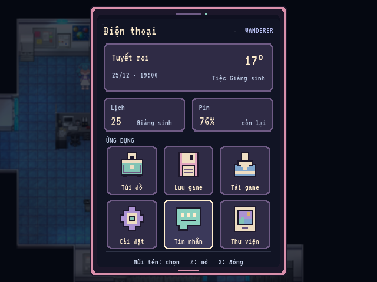
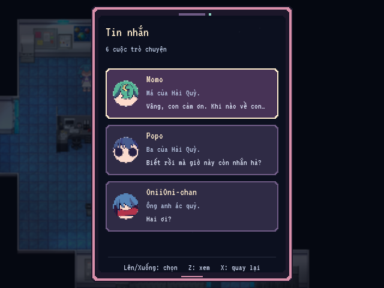
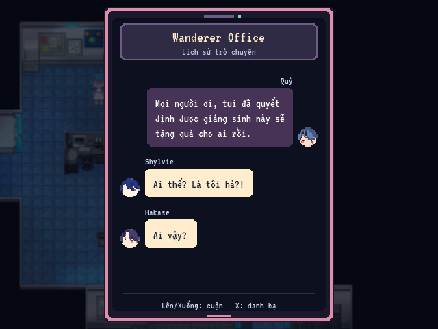

# Mẫu điện thoại pixel — 19/11/2026

Mẫu để tác giả duyệt trang chính và Tin nhắn trước khi mở rộng theme. Chỉ source `Custom Menu` tại slot 198 thay đổi; giữ nguyên 222 slot, ID/tên/thứ tự, 221 dòng CSV, mọi map/event và dữ liệu người chơi. Backup: `Data/codex_backup_phone_pixel_preview_20261119/`.

## Ảnh từ RGSS

Ảnh lấy từ bản sao QA chạy Game.exe/renderer RGSS thật, tại độ phân giải 640×480. Điều khiển bằng lệnh vào handler; không dùng bàn phím/chuột thật. Nội dung điện thoại được dựng từ checkpoint siêu thị có sẵn trong Test Hub; không thêm hoặc sửa thoại game để làm mẫu. Chưa dùng các ảnh này để kết luận FPS hoặc trải nghiệm điều khiển vật lý.

## Thiết kế và phạm vi

- Vỏ hồng, nền tím đậm, chữ kem; khung góc bậc thang, viền chọn màu kem. Sáu icon mới vẽ bằng fill_rect trên lưới 2 px, bitmap 50×50 hiển thị 1:1; bỏ scale pulse ở các icon mẫu.
- Font VT323 của Peter Hull, hỗ trợ tiếng Việt, kèm font gốc và giấy phép OFL trong Fonts/. RGSS nạp font từ dự án, không cài vào Windows. Chỉ helper của trang chính/Tin nhắn dùng font mới, các ứng dụng khác vẫn dùng UI_FONT hiện có.
- Danh sách hội thoại, avatar và bong bóng dùng lưới pixel; avatar được lấy mẫu vào bitmap riêng tại kích thước hiển thị, không ghi đè asset gốc hoặc bitmap Cache.
- Hướng dẫn phím dùng chữ “Lên/Xuống” ở mẫu vì font không có glyph mũi tên cần dùng. Tin chưa đọc hiện dấu vuông đỏ/kem, giữ nguyên logic đọc hết nội dung mới bỏ dấu.
- Gallery, Save/Load, Cài đặt, Thư viện vật phẩm và điện thoại cutscene nằm ngoài hai màn mẫu. UI chọn theme bằng PhoneMenu::PIXEL_PREVIEW và phone_pixel_preview?, không lưu cờ thiết kế trong save.
- Giữ cache widget/wrap hiện tại; không đọc font/ảnh từ ổ đĩa trên từng frame. Icon, avatar và nền tạo lúc dựng màn hình, được dọn qua lifecycle sprite hiện có.

## Xác minh

- tools/test_phone_menu_layout.rb: 25 test / 673 assertion đạt; tools/test_phone_unread.rb: 45 / 1.192 đạt; tools/test_phone_menu_animation.rb: 32 / 803 đạt. Các bộ test có kế thừa test hiệu năng cũ; không cộng các số này thành số ca độc lập. Spy tests giữ kiểm tra layout gốc/cơ chế dùng chung; theme pixel được xác minh bằng native fixture bên dưới.
- tools/qa_phone_pixel_preview_native.rb tại Save/PhonePixelPreviewQA_20261119_2/: 59 assertion đạt, font VT323 hiện diện, icon không scale lẻ, chữ Việt nằm trong vùng, render không sửa transcript, thoát dọn bitmap riêng và giữ bitmap Cache.
- Native unread/save/load tại Save/PhonePixelUnreadQA_20261119/: 27 assertion đạt, dấu tin mới, đọc từng phần tin dài, tách trạng thái giữa các save và Test Hub hoạt động đúng.
- Kiểm tra glyph bằng FreeType/Pillow: 4.478 ký tự, 122 ký tự khác nhau trong các khung chat trích từ game đều có glyph trong VT323; kiểm tra có chuẩn hóa NFC để đối chiếu glyph, không ghi lại dữ liệu game.
- Inventory đạt 222 slot / 221 CSV, chỉ slot 198 thay đổi so với backup. Nguồn font tải từ kho Google Fonts chính thức và giữ nguyên file TTF.

## Trước khi phát hành theme đã duyệt

Đây là mẫu trong workspace, chưa tạo Release mới. Updater/build hiện chưa quản lý thư mục Fonts; khi phát hành theme cần thêm font/giấy phép vào manifest và kiểm tra tải font qua updater. Fallback hiện tại vẫn dùng UI_FONT nếu font chưa được nạp; đây không thay thế bước đóng gói font.
