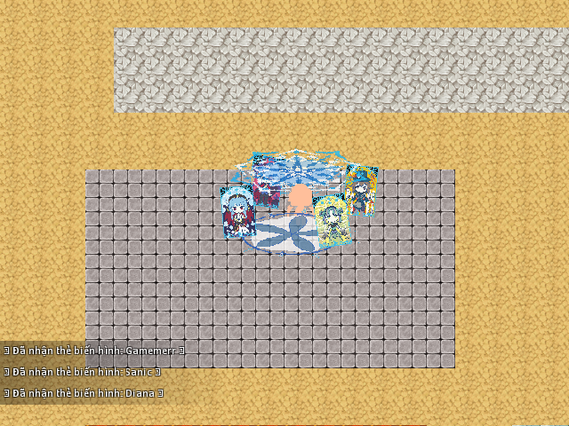

# Biến hình magical girl — 20/11/2026

Hệ thống hiện dùng đúng bốn dạng và chuỗi **125 → chọn thẻ → 127**. Dạng Diana dùng `!$HaiQuy_Diana` theo xác nhận mới nhất của tác giả.

| ID để unlock | Ảnh chọn | Character | Variable 4 | Nhận trong game |
|---|---|---|---:|---|
| `:riu` | `TFCard1` | `!$HaiQuyRiu` | 1 | Có sẵn khi bắt đầu game |
| `:gamemerr` | `TFCard2` | `!$Gamemerr` | 2 | Đạt 1.000 điểm Invaders tại siêu thị Map019 |
| `:sanic` | `TFCard3` | `!$Sanic` | 3 | Đạt 1.000 điểm CattoPetting ở phòng Kohi Map046 |
| `:diana` | `TFCard4` | `!$HaiQuy_Diana` | 4 | Đủ 10 RAM, hoàn thành cuộc gặp Diana tại Map038 |

Mở thẻ tự động tại đúng mốc ở bảng trên; mỗi lần mở đồng thời ghi nhận TFCard tương ứng trong thư viện vật phẩm. Có thông báo khi nhận thẻ mới. Riu được ghi nhận ngay khi bắt đầu game. Hướng dẫn sau cảnh mở đầu Silverwing có câu “Bấm phím D để dùng phép biến hình.” Unlock lưu trong Game_System của save hiện tại, không tự mở cho mọi lần chơi. Phím gọi phép vẫn là `Input::Z` theo mapping hiện có; chọn thẻ dùng mũi tên, Z xác nhận, X hủy. Hủy trong màn hình chọn thẻ khôi phục sprite gốc đã lưu trước lần biến hình, đặt Variable 4 về 0 và chạy 127 để trả màu bình thường. Nếu đang ở dạng gốc thì giữ nguyên dạng đó.

## Animation và hình ảnh

- **125 — Transform Magic - Cast:** 48 frame, `<rate: 3><follow><above>`, khoảng 2,4 giây ở 60 fps. Hai loại vòng phép ở trên đầu và dưới chân xoay ngược chiều, bốn lá bài bay vòng quanh. Body player dần phủ đúng màu `#FFBF9B`, rồi hai vòng nhập vào giữa cơ thể. Không còn vòng phép chính diện.
- Menu chọn thẻ giữ màu body và snapshot của pose cuối; không để nhân vật trở về màu bình thường giữa hai phần.
- **127 — Transform Magic - Reveal:** 32 frame ở rate 3, khoảng 1,6 giây. Sprite mới xuất hiện dưới lớp màu phủ; màu tan dần, hai vòng đi qua người rồi thu nhỏ/biến mất, các lá bài bay ra và tan đi. Frame đầu khớp vị trí/pattern của cuối 125.
- Atlas `Graphics/Animations/TransformMagic.png` giữ nguyên hai hàng vòng phép và dùng lại bốn lá bài cũ để tránh lộ các thẻ sưu tập. TFCard1–4 chỉ dùng cho màn hình chọn dạng và thư viện; ảnh Pictures gốc được giữ nguyên. Các cell, vị trí, scale, opacity và SE chỉnh được trong Database.
- Tint body do script áp dụng lên riêng Sprite_Character của player; không đổi màu cả map hoặc các lá bài. Rate của Victor và tint chỉ chạy trong Game.exe; Preview của Database có thể chậm hơn và không thể hiện phần tint của script.

Preview chuyển động và ảnh thư viện: `Save/TransformCardRewards/preview.html`. Link preview cũ chuyển tới bản này.

## Dọn phiên bản cũ và đồng bộ event

- Xóa registry hai dạng/ảnh chọn cũ và các alias cũ; chỉ có bốn định nghĩa trong bảng trên. API từ chối ID không có trong registry.
- Làm rỗng ô **123–124**, giữ ID và vị trí các ô Database khác (đặc biệt 126). Script dùng 125/127.
- Bỏ các lệnh unlock prototype không hợp lệ ở Map005/Map008; giữ vị trí, graphic và page của event.
- Nút reset thử ở Map008 dùng `TransformMagic.revert`, thay cho việc chỉ ghi Variable 4 = 0 rồi để nguyên sprite biến hình.
- Phần thưởng Map019 dùng `:gamemerr`; hook điểm Invaders mở ngay khi đạt 1.000 điểm tại Map019. CattoPetting chỉ mở Sanic khi đạt 1.000 điểm ở Map046, không tính các map demo khác.
- Ba chỗ thay trang phục trong Map006 E004 và Map013 E097 dùng `tm_change_actor_graphic(...)`: chạy cả 125 và 127 theo lượt, không mở màn hình chọn. Khi đổi về trang phục người trong kịch bản, reset cả biến form và thông tin sprite gốc để không mang dạng cũ sang cảnh sau.
- Map013 E097/E098 chỉ dùng phản ứng dạng cá khi form = 1. Comment đầu page `<transform form: riu>` bổ sung so khớp chính xác; không dùng điều kiện Variable >= 1 cho cả bốn dạng. Parser chỉ xét khối comment đầu page để không quét lại toàn bộ thoại mỗi lần refresh.
- Các tài nguyên biến hình đã nghỉ dùng được đưa khỏi Graphics. File NPC `!$Diana` được giữ; đó không phải sprite của dạng biến hình.

## Lifecycle và sửa lỗi

- Khóa di chuyển/tương tác trong cả hai nửa animation; hủy state và trả lại màu khi bị thoại, chuyển map hoặc scene khác cắt ngang.
- Ảnh thẻ thuộc Cache.picture; scene không dispose bitmap dùng chung. Snapshot tự tạo được dọn sau selector.
- Galv Char Effects tạo lại character sprites trong lúc Scene_Map khởi tạo. Phát 127 trước bước này làm mất animation dù bộ đếm/tint vẫn chạy. Nay 127 chỉ khởi phát sau spriteset cuối cùng và vẽ pose 0 ngay tại rate boundary của Victor, tránh frame trống đầu phần tiếp nối.
- Event Hub gọi `TransformMagic.request_cast`: chờ interpreter kết thúc cả lần yield cuối mới chạy 125, tránh phép bị hủy ngay vì engine vẫn coi event đang chạy. Yêu cầu tự xóa nếu chuyển map hoặc scene.
- Hệ thống thẻ hiện cập nhật các slot **198 — Custom Menu**, **206 — Transform Form Selection**, **209 — Catto Petting Minigame**; vẫn **222 slot/221 dòng CSV**, giữ ID, tên và thứ tự.

## Thẻ sưu tập và Diana

Bốn TFCard bổ sung vào thư viện, tổng mặc định **49 mục**. Mục chưa mở giấu tên/ảnh. Mô tả do tác giả cung cấp:

- Riu: Hình dạng nguyên thuỷ của Hải Quỳ.
- Gamemerr: Gêm Mờ khẩm dô. Chẳng chơi được Game mấy, toàn để bị Game chơi.
- Sanic: Một con nhím màu xanh di chuyển rất nhanh nhưng trông hơi kỳ quặc.
- Diana: Bé gái người máy dễ thương.

Bộ sưu tập giữ qua các lượt chơi trong `Save/ItemLibrary.rvdata2`; danh sách phép đã mở vẫn thuộc save đang chơi. Mở thư viện sẽ ghi nhận các dạng đã mở trong save hiện có. Không xóa file/key khám phá cũ. Các thẻ không thêm vào Gallery.

CE20 chỉ nhận một RAM và phát suy nghĩ, rồi gọi **CE21**. CE21 giữ nguyên staging/thoại/camera Diana, kiểm tra Map038, ít nhất 10 RAM và Switch 82 chưa bật; mở Diana sau đoạn thoại. Khi mang đủ RAM từ nơi khác vào Map038, script đợi free roam và gọi cùng CE21; không nhận thêm RAM, không tạo bản sao cutscene và không chiếm một Common Event đang được queue. Farm RAM và cờ hoàn tất một lần vẫn giữ nguyên.

## Kiểm tra

- **200 kiểm tra native RGSS301/Ruby 1.9.2 đạt**: chuỗi 125/127 với lá bài cũ, bốn form, X hủy khôi phục dạng gốc, frame đầu 127, màu/tài nguyên/input khi gián đoạn, yêu cầu biến hình từ event, thư viện 49 mục, Riu mở sẵn và ba thẻ còn giấu ảnh, bốn mô tả vừa khung với font thật.
- **66 test / 2.122 assertion đạt**: gồm thư viện/Save/Load/Settings và 10 case điều kiện thẻ. Đã kiểm tra 999/1.000 điểm, đúng/sai map, chỉ ghi nhận một lần, 9/10 RAM, cờ hoàn tất, giữ queue Common Event khác, chờ event kết thúc trước khi niệm phép và giữ bộ sưu tập sau khi reset thẻ/New Game. Không tuyên bố đã chơi minigame bằng bàn phím thật hoặc chạy đủ cutscene Diana trong lượt này.
- Audit RAM và inventory script không lỗi.
- Log/ảnh/kết quả: `Save/TransformCardRewards/verified/`; phạm vi và đối chiếu pixel atlas: `scope-result.json`, `atlas-verification.json` tại thư mục cha.
- Chỉ thay danh sách lệnh Map003 E003 và Test Hub E043 trong lượt thêm điều kiện thẻ; giữ geometry, page setting và toàn bộ 40 event Hub khác. Thoại Diana giữ nguyên khi chuyển sang CE21. Web app QA không đổi.
- Backup trước cập nhật thẻ: `Data/codex_backup_transform_cards_20261120_195725/`. Các backup của đợt dựng animation trước vẫn được giữ.

`tools/build_transform_animation.rb --apply` dựng dữ liệu 125/127, làm rỗng 123/124, đồng bộ slot 206 và bảo đảm tag dạng cá. `tools/update_transform_cards.rb --apply` cập nhật registry/reward/library, CE20/21 và đúng hai event nêu trên, có backup và kiểm tra scope. Không dùng công cụ dựng lại map hoặc sort script. Xem [Test Hub](../production/test-hub.md) để chọn bộ thẻ cần thử.
