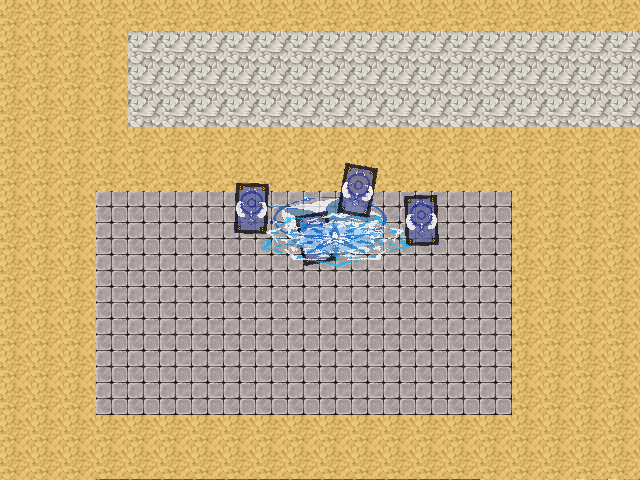

# Biến hình magical girl — 20/11/2026

Hệ thống hiện dùng đúng bốn dạng và chuỗi **125 → chọn thẻ → 127**. Dạng Diana dùng `!$HaiQuy_Diana` theo xác nhận mới nhất của tác giả.

| ID để unlock | Ảnh chọn | Character | Variable 4 | Nhận trong game |
|---|---|---|---:|---|
| `:riu` | `TFCard1` | `!$HaiQuyRiu` | 1 | Có sẵn khi bắt đầu game |
| `:gamemerr` | `TFCard2` | `!$Gamemerr` | 2 | Đạt 1.000 điểm Invaders tại siêu thị Map019 |
| `:sanic` | `TFCard3` | `!$Sanic` | 3 | Đạt 1.000 điểm CattoPetting ở phòng Kohi Map046 |
| `:diana` | `TFCard4` | `!$HaiQuy_Diana` | 4 | Đủ 10 RAM, hoàn thành cuộc gặp Diana tại Map038 |

Mở thẻ tự động tại đúng mốc ở bảng trên; mỗi lần mở đồng thời ghi nhận TFCard tương ứng trong thư viện vật phẩm. Có thông báo khi nhận thẻ mới. Riu được ghi nhận ngay khi bắt đầu game. Hướng dẫn sau cảnh mở đầu Silverwing có câu “Bấm phím D để dùng phép biến hình.” Unlock lưu trong Game_System của save hiện tại, không tự mở cho mọi lần chơi. Phím gọi phép vẫn là `Input::Z` theo mapping hiện có; chọn thẻ dùng mũi tên, Z xác nhận, X hủy. Hủy trong màn hình chọn thẻ khôi phục sprite gốc đã lưu trước lần biến hình, đặt Variable 4 về 0 và chạy 127 để trả màu bình thường. Nếu đang ở dạng gốc thì giữ nguyên dạng đó.

## Animation và hình ảnh

- **125 — Transform Magic - Cast:** 48 frame, `<rate: 3><follow><above>`, khoảng 2,4 giây ở 60 fps. Hai loại vòng phép ở trên đầu và dưới chân; bốn lá bài chuyển động theo bố cục ban đầu, chỉ nghiêng nhẹ tối đa 10°. Body player dần phủ đúng màu `#FFBF9B`, rồi hai vòng nhập vào giữa cơ thể.
- Menu chọn thẻ giữ màu body và snapshot của pose cuối; không để nhân vật trở về màu bình thường giữa hai phần.
- **127 — Transform Magic - Reveal:** 32 frame ở rate 3, khoảng 1,6 giây. Sprite mới xuất hiện dưới lớp màu phủ; màu tan dần, hai vòng đi qua người rồi thu nhỏ/biến mất. Bốn lá tiếp tục chuyển động cũ, tản lên và tan. Frame đầu khớp vị trí/pattern của cuối 125.
- Atlas `Graphics/Animations/TransformMagic.png` dùng mặt lưng bộ bài mới ở bốn cell 10–13 giống nhau. Không lộ hình hay silhouette dạng chưa mở. TFCard1–4 chỉ dùng cho màn hình chọn dạng đã mở và thư viện; ảnh Pictures gốc được giữ nguyên. Các cell, vị trí, scale, opacity và SE chỉnh được trong Database.
- Tint body do script áp dụng lên riêng Sprite_Character của player; không đổi màu cả map hoặc các lá bài. Rate của Victor và tint chỉ chạy trong Game.exe; Preview của Database có thể chậm hơn và không thể hiện phần tint của script.

Preview hiện tại: `Save/TransformRestoreQA_20261123/preview.html`. Các link preview cũ chuyển tới bản này.

## Dọn phiên bản cũ và đồng bộ event

- Xóa registry hai dạng/ảnh chọn cũ và các alias cũ; chỉ có bốn định nghĩa trong bảng trên. API từ chối ID không có trong registry.
- Làm rỗng ô **123–124**, giữ ID và vị trí các ô Database khác (đặc biệt 126). Script dùng 125/127.
- Bỏ các lệnh unlock prototype không hợp lệ ở Map005/Map008; giữ vị trí, graphic và page của event.
- Nút reset thử ở Map008 dùng `TransformMagic.revert`, thay cho việc chỉ ghi Variable 4 = 0 rồi để nguyên sprite biến hình.
- Phần thưởng Map019 dùng `:gamemerr`; hook điểm Invaders mở ngay khi đạt 1.000 điểm tại Map019. CattoPetting chỉ mở Sanic khi đạt 1.000 điểm ở Map046, không tính các map demo khác.
- Ba chỗ thay trang phục trong Map006 E004 và Map013 E097 dùng `tm_change_actor_graphic(...)`: chạy cả 125 và 127 theo lượt, không mở màn hình chọn. Khi đổi về trang phục người trong kịch bản, reset cả biến form và thông tin sprite gốc để không mang dạng cũ sang cảnh sau.
- Comment đầu page `<transform form: riu>` bổ sung so khớp chính xác, tránh điều kiện Variable >= 1 cho cả bốn dạng. Từ 21/11, riêng hai page Riu cũ của Map013 E097/E098 được bỏ qua lúc chọn page để nhường cho hệ thống phản hồi chung bên dưới; không xóa hoặc sửa dữ liệu page trong map. Parser của các tag còn lại chỉ xét khối comment đầu page.
- Các tài nguyên biến hình đã nghỉ dùng được đưa khỏi Graphics. File NPC `!$Diana` được giữ; đó không phải sprite của dạng biến hình.

## Lifecycle và sửa lỗi

- Khóa di chuyển/tương tác trong cả hai nửa animation; hủy state và trả lại màu khi bị thoại, chuyển map hoặc scene khác cắt ngang.
- Ảnh thẻ thuộc Cache.picture; scene không dispose bitmap dùng chung. Snapshot tự tạo được dọn sau selector.
- Galv Char Effects tạo lại character sprites trong lúc Scene_Map khởi tạo. Phát 127 trước bước này làm mất animation dù bộ đếm/tint vẫn chạy. Nay 127 chỉ khởi phát sau spriteset cuối cùng và vẽ pose 0 ngay tại rate boundary của Victor, tránh frame trống đầu phần tiếp nối.
- Event Hub gọi `TransformMagic.request_cast`: chờ interpreter kết thúc cả lần yield cuối mới chạy 125, tránh phép bị hủy ngay vì engine vẫn coi event đang chạy. Yêu cầu tự xóa nếu chuyển map hoặc scene.
- Hệ thống thẻ hiện cập nhật các slot **198 — Custom Menu**, **206 — Transform Form Selection**, **209 — Catto Petting Minigame**; vẫn **222 slot/221 dòng CSV**, giữ ID, tên và thứ tự.

## Thẻ sưu tập và Diana

Bốn TFCard bổ sung vào thư viện, tổng mặc định **49 mục**. Mục chưa mở giấu tên/ảnh. Mô tả do tác giả cung cấp:

- Riu: Hình dạng nguyên thuỷ của Hải Quỳ.
- Gamemerr: Gêm Mờ khẩm dô. Chẳng chơi được Game mấy, toàn để bị Game chơi.
- Sanic: Một con nhím màu xanh di chuyển rất nhanh nhưng trông hơi kỳ quặc.
- Diana: Bé gái người máy dễ thương.

Bộ sưu tập giữ qua các lượt chơi trong `Save/ItemLibrary.rvdata2`; danh sách phép đã mở vẫn thuộc save đang chơi. Mở thư viện sẽ ghi nhận các dạng đã mở trong save hiện có. Không xóa file/key khám phá cũ. Các thẻ không thêm vào Gallery.

CE20 chỉ nhận một RAM và phát suy nghĩ, rồi gọi **CE21**. CE21 giữ nguyên staging/thoại/camera Diana, kiểm tra Map038, ít nhất 10 RAM và Switch 82 chưa bật; mở Diana sau đoạn thoại. Khi mang đủ RAM từ nơi khác vào Map038, script đợi free roam và gọi cùng CE21; không nhận thêm RAM, không tạo bản sao cutscene và không chiếm một Common Event đang được queue. Farm RAM và cờ hoàn tất một lần vẫn giữ nguyên.

## Kiểm tra

- **200 kiểm tra native RGSS301/Ruby 1.9.2 đạt**: chuỗi 125/127 với lá bài cũ, bốn form, X hủy khôi phục dạng gốc, frame đầu 127, màu/tài nguyên/input khi gián đoạn, yêu cầu biến hình từ event, thư viện 49 mục, Riu mở sẵn và ba thẻ còn giấu ảnh, bốn mô tả vừa khung với font thật.
- **66 test / 2.122 assertion đạt**: gồm thư viện/Save/Load/Settings và 10 case điều kiện thẻ. Đã kiểm tra 999/1.000 điểm, đúng/sai map, chỉ ghi nhận một lần, 9/10 RAM, cờ hoàn tất, giữ queue Common Event khác, chờ event kết thúc trước khi niệm phép và giữ bộ sưu tập sau khi reset thẻ/New Game. Không tuyên bố đã chơi minigame bằng bàn phím thật hoặc chạy đủ cutscene Diana trong lượt này.
- Audit RAM và inventory script không lỗi.
- Log/ảnh/kết quả: `Save/TransformCardRewards/verified/`; phạm vi và đối chiếu pixel atlas: `scope-result.json`, `atlas-verification.json` tại thư mục cha.
- Chỉ thay danh sách lệnh Map003 E003 và Test Hub E043 trong lượt thêm điều kiện thẻ; giữ geometry, page setting và toàn bộ 40 event Hub khác. Thoại Diana giữ nguyên khi chuyển sang CE21. Web app QA không đổi.
- Backup trước cập nhật thẻ: `Data/codex_backup_transform_cards_20261120_195725/`. Các backup của đợt dựng animation trước vẫn được giữ.

`tools/build_transform_animation.rb --apply` dựng dữ liệu 125/127, làm rỗng 123/124, đồng bộ slot 206 và bảo đảm tag dạng cá. `tools/update_transform_cards.rb --apply` cập nhật registry/reward/library, CE20/21 và đúng hai event nêu trên, có backup và kiểm tra scope. Không dùng công cụ dựng lại map hoặc sort script. Xem [Test Hub](../production/test-hub.md) để chọn bộ thẻ cần thử.

## Phản hồi NPC — 21/11/2026

Tác giả đã duyệt bản thoại nháp và yêu cầu thực hiện bằng script, thay cho chèn lệnh vào từng event. `NPCFormReaction` nằm cùng slot **206**, ở cuối `Scripts/Transform Form Selection.rb`. Bản này chỉ thay pack Scripts và source slot 206; toàn bộ file map, Common Events, vị trí/graphic/priority/walk/step/page setting và Test Hub giữ nguyên từng byte.

### Khi nào phản hồi

- Hook `Game_Player#check_action_event` đánh dấu phạm vi thao tác tương tác. `Game_Interpreter#setup` chỉ thay danh sách lệnh của interpreter chính khi được gọi trong phạm vi này. Autorun, parallel, chạm trigger, interpreter con và event được script gọi ngoài thao tác tương tác vẫn dùng nội dung gốc.
- Dạng hiện tại phải khớp cả Variable 4, character filename và index trong registry bốn dạng. Dạng người bình thường không phản hồi. Không chạy trong animation biến hình, lúc ẩn player, chuyển map, message còn mở, menu bị khóa hoặc có Common Event đang chờ.
- Danh sách có giao/trừ item, transfer, shop, battle, nhập dữ liệu hoặc chuyển scene hệ thống được ưu tiên chạy nguyên bản. Chọn quà/thanh toán và cảnh bắt buộc không bị thay bằng một câu đùa. Với tương tác trò chuyện/free roam, NPC tiếp tục phản hồi theo dạng đang dùng; muốn trở lại thoại thường hoặc lời mời ném tuyết/CattoPetting thì hủy biến hình trước.
- Không quét mọi NPC mỗi frame. Phân loại, rút thoại và tạo lệnh Show Text chỉ thực hiện khi tương tác.

### Nhận diện NPC và hitbox

| Nguồn nhận diện | Cách dùng |
|---|---|
| Tên event `NPC-LEO`, `NPC-SHYLVIE`, `NPC-KOHI`, `NPC-HAKASE` | Nhận diện thành viên Wanderer và các phiên bản map bằng tên, không theo tọa độ |
| Sprite `$NPC_Chart`, `$NPC_Chart2`, `$Oguri_nomnom` | NPC phụ dùng nhóm thoại chung; không suy đoán mọi object có graphic là NPC |
| `PARALLAX` trong module | Cấu hình tập trung các NPC đã bake trên nền: Silverwing E022→Beta E004, E027→Alpha E005; Map013 Leo/Shylvie; hai người bán ở Map019 và các controller Map058 |
| Hitbox có `$game_map.events[n].start # WCF_CAFE_HITBOX_...` | Giải về controller, dùng chung lịch sử phản hồi; có giới hạn độ sâu và tránh vòng lặp |
| Huyền Mây/Vân Phượng | Chung controller E025; lấy anchor 25 hoặc 26 từ camera focus của page đang chạy |
| Diana Map038 E018 | Khi Switch 48/82 bật và sprite `!$Diana` hiện, script cho phép tương tác dù list gốc rỗng; không thêm event hoặc page |

Main dùng chung identity theo tên nhân vật giữa các map. NPC phụ dùng `[map_id, controller_id]`, nên chuyển sang hitbox khác không khiến NPC coi như vừa gặp lại lần đầu. Không tự cho người lạ biết thân phận hay nguồn gốc Hải Quỳ.

### Thoại, hiển thị và lưu trạng thái

- Dùng nguyên các câu đã duyệt: **16 phản hồi chính** cho bốn thành viên Wanderer, ba câu riêng của Alpha/Beta/Diana, **16 câu chung** và bốn câu dành cho người bán hàng. Có hai đối đáp đã duyệt: Riu phát “Ọc ọc ọc!” và Shylvie cà khịa trình độ chơi game.
- Lần đầu mỗi NPC thấy một dạng dùng đoạn riêng đầy đủ và balloon; các lần sau luân phiên câu ngắn/câu riêng đã duyệt nếu có nhiều câu khác nhau. Khi Hải Quỳ còn biến hình, mọi lần tương tác trò chuyện đều dùng phản hồi của đúng dạng đó. Chỉ sau khi hủy biến hình mới chạy lại list thoại thường. Phản hồi không tăng switch/variable tiến độ của event.
- NPC phụ dùng túi rút ngẫu nhiên. Tránh lặp ngay câu vừa nói của cùng NPC lẫn câu gần nhất từ NPC cùng nhóm; khi ứng viên cuối túi vừa bị NPC bên cạnh dùng, tạm hoãn ứng viên đó và rút câu an toàn khác.
- Pop trỏ đúng NPC/anchor; Hải Quỳ dùng anchor 0. Face chọn theo tên NPC và sprite thường/Giáng sinh, chỉ dùng asset đang có. Phản hồi Shylvie mới trỏ E098; câu toilet cũ của Shylvie cũng được sửa anchor 97→98 trong bản sao list lúc chạy, không ảnh hưởng lời Leo thật ở page hội thoại khác.
- Tự xuống dòng tối đa 33 ký tự khi có face, 40 khi không có face; chia tối đa bốn dòng mỗi khung. Đếm chữ gốc kèm dấu kết hợp thành một ký tự để không tính thừa dấu tiếng Việt. Không tự đổi lời thoại đã duyệt.
- `Game_System#npc_form_reactions` lưu `seen`, túi rút và câu gần nhất. Dữ liệu thuộc save hiện tại; save/load giữ trạng thái, Game mới bắt đầu lại. Cờ `base_next` của bản đầu được loại bỏ khi đọc trạng thái, giữ nguyên lịch sử và túi random. Bản sửa áp dụng cho save đang chơi, không cần Game mới. Không tạo file bộ sưu tập/global mới và không thay điều kiện mở thẻ.

### Xác minh

`ruby tools/test_npc_form_reactions.rb` đạt **21 case / 1.141 assertion**: đúng/sai dạng, scope tương tác, bảo vệ nhiệm vụ/object, alias và cặp NPC, mười lần phản hồi liên tiếp cho từng dạng, chỉ trở lại thoại thường sau hủy phép, random không lặp, giới hạn dòng/chữ Unicode, save/load và dọn flag khi có lỗi. Có ca nạp trạng thái cũ chứa `base_next=true` để kiểm tra cờ đó không làm quay về thoại thường. Bộ điều kiện mở thẻ trước đó đạt **10 case / 46 assertion**; bản sửa này không đổi phần thưởng thẻ.

Native RGSS301/Ruby 1.9.2 đạt **352 kiểm tra**: gọi thật `Game_Player#check_action_event`, chạy interpreter và render pop cho 16 tổ hợp Wanderer, Alpha/Beta, Diana, bốn dạng với NPC siêu thị. Tương tác lần hai/lần ba vẫn phản hồi biến hình, lần hai có câu khác; hủy phép thật mới chạy thoại thường. Đổi giữa các hitbox Karin vẫn tiếp tục phản hồi, không tăng Switch 81/Variable 82; sau hủy phép, hội thoại gốc mới tiến triển. Trạng thái save cũ chứa cờ luân phiên cũng tiếp tục phản hồi đúng dạng Riu. Các cửa sổ nằm trong màn hình, pop có anchor hợp lệ và message thường của Karin xóa trạng thái pop. Marshal thật giữ lịch sử, Game_System mới không kế thừa lịch sử. Không coi đây là lượt chơi lại toàn bộ route bằng bàn phím vật lý.

Bằng chứng bản sửa phản hồi liên tục: `Save/NPCFormReactionsContinuousQA_20261121/native/` (log, ảnh, kết quả), `native-result.json`, `scope-result.json`. Snapshot trước sửa nằm cùng thư mục cha. Bằng chứng bản đầu vẫn ở `Save/NPCFormReactionsQA_20261121/`. Bản runner và junction tài nguyên được dọn sau xác minh; giữ ảnh/log để review. Inventory vẫn **222 slot/221 dòng CSV**. Web app QA không đổi.

Để tự playtest, mở thẻ ở Test Hub E043 rồi thử: Leo/Shylvie trước khi rời Wanderer, các thành viên trong free roam Giáng sinh, Diana sau cuộc gặp đủ RAM, NPC siêu thị và các hitbox của cùng NPC quán cà phê. Bấm tương tác nhiều lần khi chưa hủy phép phải tiếp tục phản hồi đúng dạng; hủy phép rồi tương tác mới xem được thoại thường hoặc mở minigame. Chọn quà/thanh toán phải tiếp tục đúng nhánh.

## Khôi phục chuyển động ban đầu — 23/11/2026

Theo yêu cầu tác giả, đã bỏ các thử nghiệm thêm bài/xoay riêng, chồng bài xòe quạt và vòng ellipse sáu lá. Animations **125/127 được khôi phục byte-identical** từ snapshot trước lần thêm bài ngày 23/11 (`Save/TransformCardBackQA_20261123/Animations.rvdata2`), tương ứng 48/32 frame, bốn lá bài và sáu cell tối đa gồm hai vòng phép. Dựng lại bằng `tools/build_transform_animation.rb` cho cùng dữ liệu.

Khôi phục cách sắp lớp trước/sau người chơi theo vị trí dọc của cell. Giữ nguyên mặt lưng bài mới không có hình nhân vật, các bản sửa selector/hủy phép, màu body, điều kiện mở thẻ và toàn bộ phản hồi NPC. Chỉ Animations 125/127 cùng slot 206 thay trong Data; map, event, asset và thứ tự 222 slot giữ nguyên.

Bằng chứng, snapshot trước khôi phục và preview: `Save/TransformRestoreQA_20261123/`. Preview các bản thử trước chuyển tới bản khôi phục này. Kết quả native và đối chiếu phạm vi nằm trong `native-result.json`, `scope-result.json`; giữ ảnh/log và dọn runner sau xác minh.

Xác minh bản khôi phục: **215 kiểm tra native RGSS301 đạt** với bốn dạng, thao tác hủy, chuyển trang phục từ event, nối selector/127, tint và dọn state. Đối chiếu dữ liệu xác nhận 125/127 bằng bản gốc, builder tái tạo đúng cùng dữ liệu, không đổi các file map hoặc ảnh và không sửa phần script ngoài hook sắp lớp animation. Inventory **222 slot/221 dòng CSV, không lỗi**.
