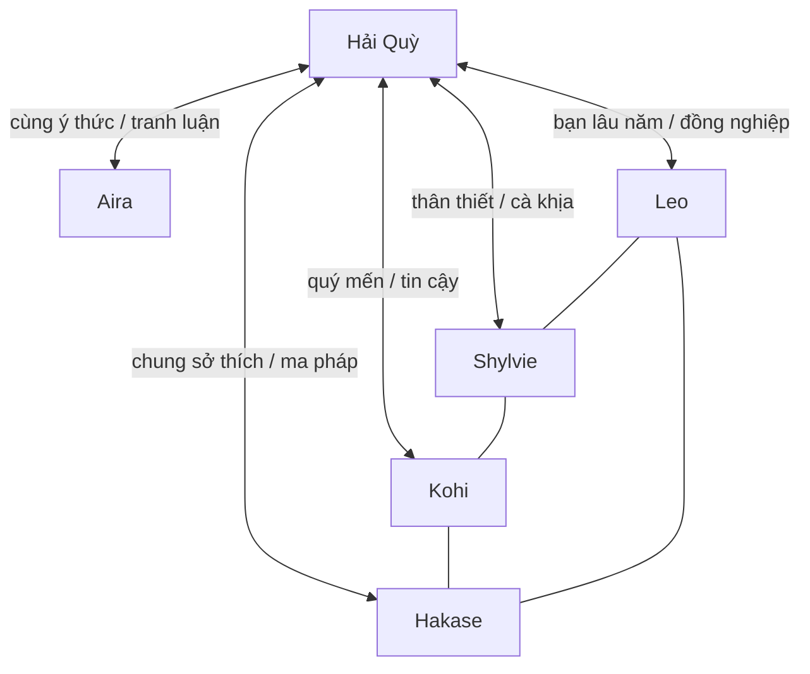

# 02 — Nhân vật

## 1. Quy tắc viết nhân vật

- Lời dẫn bám theo PoV Hải Quỳ.
- Không kể suy nghĩ của nhân vật khác như sự thật nếu Hải Quỳ không biết.
- Aira và Hải Quỳ có thể cùng suy nghĩ, nói chuyện và phản ứng trong một cảnh.
- Game không cần đổi tên hiển thị khi Aira kiểm soát cơ thể.
- Màu mắt và hành vi là dấu hiệu phân biệt.

## 2. Hải Quỳ

| Thuộc tính | Nội dung |
|---|---|
| Tên chính | Hải Quỳ |
| Tên thật | Dahria |
| Mật danh | Omega D-13 |
| Biệt danh | Bully Quỳ |
| Bản chất | Cỗ máy chiến đấu mang gen trích xuất từ Poseidon |
| Tổ chức | Silver Wing; thành viên Wanderer |
| Dấu hiệu | Mắt đỏ khi Hải Quỳ thể hiện/kiểm soát |

### Tính cách

- Hoạt bát, tự tin và thường tự khen mình.
- Mê ma pháp thiếu nữ, anime, game, Sonic, robot và mô hình.
- Thích đồ dễ thương, vị cam, đồ ngọt và kem socola.
- Có khả năng chiến đấu cực mạnh nhưng thường gây hỏng thiết bị hoặc đồ vật.
- Quan tâm bạn bè, dù cách tặng quà đôi khi kỳ quặc.
- Có thể chuyển nhanh từ hài hước đời thường sang lạnh lùng khi làm nhiệm vụ.
- Thường né tránh hoặc làm nhẹ đi những phần đen tối trong đời mình.

### Vai trò cốt truyện

Hải Quỳ là nhân vật điều khiển và người kể chuyện. Lựa chọn của cô xác định địa điểm mua sắm, món quà, người nhận, thứ tự vòng quà và epilogue.

### Giọng thoại

- Khẩu ngữ, nhanh, giàu cảm thán.
- Dùng `tui`, `bà`, `ông`, `ổng`, `bả` tùy quan hệ.
- Có thể hét bằng chữ in hoa trong gag.
- Hay tự tranh luận và tự hợp lý hóa quyết định.
- Khi làm Omega D-13, giọng có thể ngắn, rõ và chuyên nghiệp hơn.

### Quan hệ

- Aira: nhân cách khác, bạn đồng hành nội tâm và người thường xuyên sửa sai/cà khịa.
- Leo: bạn lâu năm, đồng nghiệp Wanderer; tương tác dễ chịu và nhiều trò đùa.
- Shylvie: thân thiết, hay đối đáp và cà khịa lẫn nhau.
- Kohi: Hải Quỳ quý mến và khó đối diện khi làm Kohi thất vọng.
- Hakase: chung sở thích game/mô hình; Hải Quỳ tin vào khả năng ma pháp của Hakase.
- Silver Wing: đồng đội và trách nhiệm nghề nghiệp không thể bỏ qua.

## 3. Aira

| Thuộc tính | Nội dung |
|---|---|
| Loại | Nhân cách khác cùng tồn tại với Hải Quỳ |
| Biểu hiện | Đối thoại nội tâm, miệng sau đầu, tóc/xúc tu, thay quyền kiểm soát |
| Nhận diện | Màu mắt khác mắt đỏ của Hải Quỳ |
| Nameplate | Vẫn có thể dùng Hải Quỳ trong game |

### Tính cách

- Thẳng thừng, ít kiên nhẫn hơn Hải Quỳ.
- Thực dụng, thường thúc Hải Quỳ ngủ hoặc hoàn thành việc cần làm.
- Có năng lực nấu nướng, tạo vật và kiểm soát cơ thể.
- Hay gọi Hải Quỳ/Dahria là con nhãi hoặc dùng lối nói trêu chọc.
- Dù tỏ vẻ khó chịu, vẫn hỗ trợ và bảo vệ Hải Quỳ.

### Quy tắc viết

- Hải Quỳ và Aira không loại trừ ý thức của nhau.
- Có thể để hai luồng suy nghĩ cùng tồn tại trong cùng cảnh.
- Nếu quyền kiểm soát đổi, phải thể hiện qua mắt, portrait, giọng hoặc hành động; không cần đổi tên nhân vật.
- Không tự viết Aira thành phản diện hay nhân vật tách khỏi Hải Quỳ.

## 4. Dahlia

Dahlia là người thật trong gia đình đã tìm thấy Hải Quỳ. Hải Quỳ mô phỏng hình dạng thời thơ ấu của Dahlia để tạo nhân dạng. Dahlia hiện đã chết.

Dahlia không phải Dahria. Không nhập hai tên hoặc tự sửa tên này thành tên kia.

## 5. Leo Murasami

| Thuộc tính | Nội dung |
|---|---|
| Chủng loài | Ma cà rồng |
| Tuổi được nhắc | Khoảng 2.000 tuổi |
| Quê | Luminous |
| Vai trò | Vệ thần không gian; thành viên kỳ cựu Wanderer |
| Vũ khí | Muramasa |
| Sở thích | Sting, game, vật phẩm Luminous |

### Tính cách và chức năng

- Dễ tính, thân thiện, có trách nhiệm với văn phòng.
- Gánh nhiều công việc giấy tờ và điều phối.
- Có khả năng biến thành dơi.
- Hiểu sở thích của các thành viên và có thể gợi ý quà.
- Thường tham gia gag nhưng biết nghiêm túc khi Hải Quỳ gặp nguy hiểm.

### Giọng thoại

Tự nhiên, thân mật, hay dùng `tui`; phản ứng lớn nhưng ít hỗn loạn hơn Hải Quỳ. Khi chỉ huy cứu hộ, lời nói ngắn và dứt khoát.

## 6. Shirogane Shylvie

| Thuộc tính | Nội dung |
|---|---|
| Vai trò | Pháp sư cận chiến dùng khiên; thành viên Wanderer |
| Sở trường | Khiên, chế tạo, phục hồi, ma pháp hỗ trợ |
| Sở thích | Khiên, game, dụng cụ bếp/chế tạo |

### Tính cách và chức năng

- Thực tế, nhanh nhạy và thường cà khịa Hải Quỳ.
- Đam mê khiên đến mức phản ứng như trẻ nhỏ khi nhận khiên mới.
- Nhận ra Hải Quỳ qua tóc, màu mắt và ma lực tốt hơn Leo.
- Thích khám phá tàn tích và thu hồi vật phẩm hơn nhiệm vụ tiêu diệt quái vật.
- Là người có thể phân tích hoặc sửa phép của Hải Quỳ.

### Giọng thoại

Châm chọc, trực diện, đôi khi cố tình nói ngược để chọc Hải Quỳ. Khi có nguy hiểm, chuyển nhanh sang nghiêm túc và bảo vệ nhóm.

## 7. Kohi

| Thuộc tính | Nội dung |
|---|---|
| Danh xưng | Quỷ Cà Phê |
| Vai trò | Thành viên Wanderer |
| Sở thích | Cà phê, nấu ăn, móc/đan, hội họa và thủ công |

### Tính cách và chức năng

- Ấm áp, vui vẻ và quan tâm mọi người.
- Có tốc độ xử lý hồ sơ nhanh.
- Có vận may nổi bật trong trò chơi.
- Quà liên quan cà phê hoặc thủ công thường phù hợp nhất với cô.
- Hải Quỳ đặc biệt ngại làm Kohi thất vọng.

### Giọng thoại

Mềm, thân thiện, có cách nói miền Trung ở một số câu như `ai rứa`. Khi phấn khích có thể nói nhanh và liên tục.

## 8. Hakase Shoichi

| Thuộc tính | Nội dung |
|---|---|
| Quá khứ | Cựu Ma Vương |
| Vai trò | Thành viên mới của Wanderer |
| Sở thích | Game, mô hình, giả kim, sách và dụng cụ ma pháp |

### Tính cách và chức năng

- Mạnh nhưng đang học cách kiểm soát sức mạnh.
- Sáng tạo, tò mò và có logic khó đoán.
- Có thể chế tạo hoặc cải tiến vật phẩm ma thuật.
- Học phép nhanh; giữ vai trò quan trọng trong ending Atlantis đặc biệt.
- Dễ phấn khích với mô hình, phép mới và vật phẩm lạ.

### Giọng thoại

Nhiệt tình, đôi lúc ngây ngô; thường gọi mọi người chú ý bằng `nhí nhí`. Khi nghiên cứu ma pháp có thể chuyển sang tập trung và tự tin.

## 9. Silver Wing — nhân vật chính trong mở đầu

### Alpha C-61

- Lười, mê game và tạo phần lớn công việc tồn đọng.
- Có linh cảm về điểm sai trong hồ sơ Lỗ Hổng Vực Sâu 61.
- Là người liên lạc khẩn với Hải Quỳ trong buổi tiệc.

### Beta M-34

- Nghiêm túc, có trách nhiệm và thường xử lý hậu quả của Alpha.
- Nhận chìa khóa hồ sơ từ Omega D-13.
- Phát hiện hoặc xác nhận điểm bất thường và yêu cầu Hải Quỳ quay lại cứu hộ.

## 10. Gia đình

### Popo

Bố của Hải Quỳ trong gia đình nhận nuôi.

### Momo

Mẹ của Hải Quỳ. Tin nhắn của Momo có thể thay đổi một số đối thoại giữa Hải Quỳ và Aira.

### Paulie/OniOnii

Paulie là OniOnii. Từng đưa Hải Quỳ tới tiệm sách phép Atlantis khi cô còn bé.

### Người anh cả

Tên thật chưa được tiết lộ và không cần xác định trong phạm vi game này.

## 11. Quan hệ nhóm Wanderer

